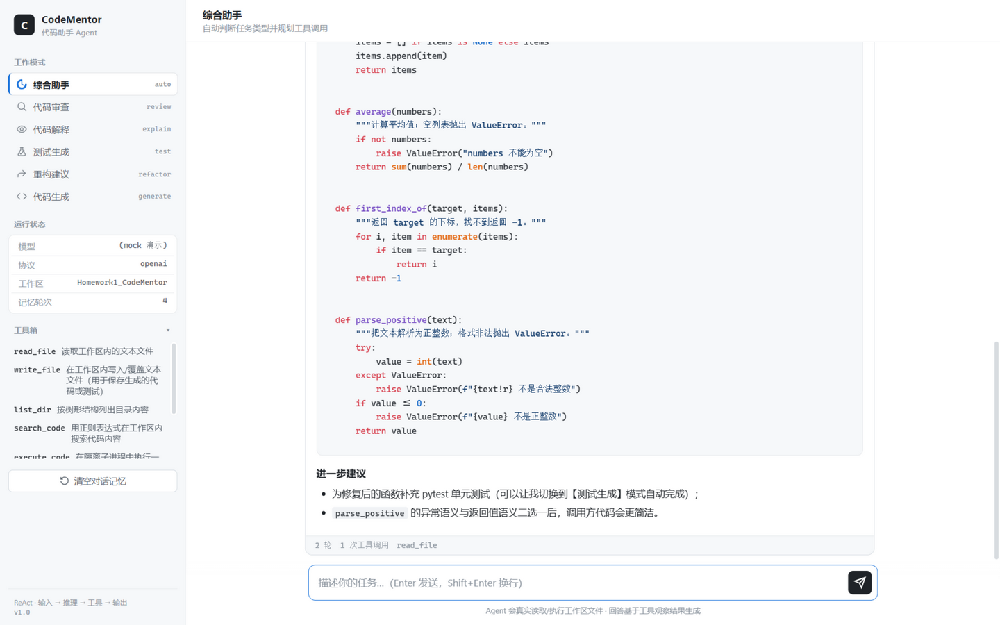
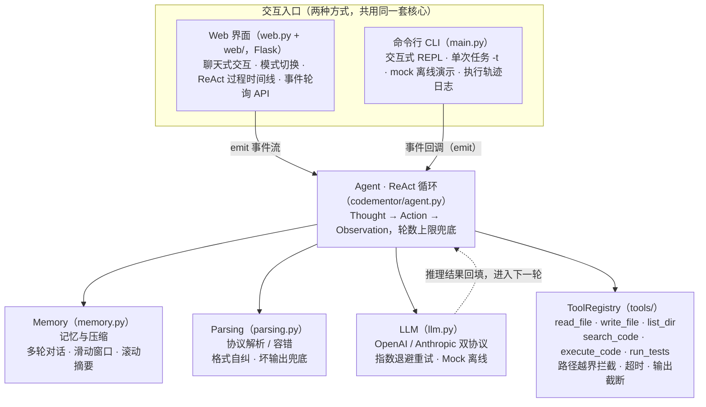
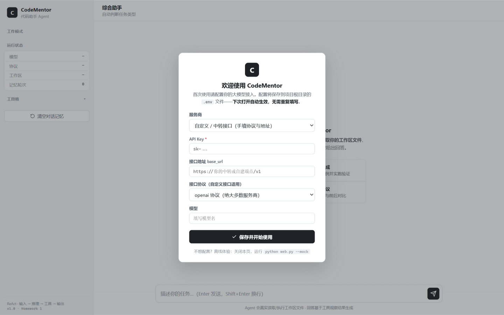

# CodeMentor · 代码助手 Agent

> 一个纯 Python 实现、零 Agent 框架依赖的 **ReAct 式代码助手 Agent**，
> 支持**代码审查 / 代码解释 / 测试生成 / 重构建议 / 代码生成**五种工作模式，
> 提供 **Web 界面** 与 **命令行** 两种交互方式，
> 通过 **OpenAI / Anthropic 双兼容协议**接入主流大模型（OpenAI / DeepSeek / 通义千问 /
> 智谱 GLM 及 Coding 套餐 / Claude / Moonshot / 本地 Ollama）。



[]() []()

---

## 1. 项目简介

CodeMentor 实现了完整的 Agent 能力闭环：

```
用户输入 → LLM 推理（Thought）→ 工具调用（Action）→ 观察结果（Observation）→ 循环 … → 最终输出
```

- **Agent 循环**：标准 ReAct 范式，`codementor/agent.py`；
- **工具集成**：6 种工具（文件读写 / 目录浏览 / 代码搜索 / 代码执行 / 测试运行），`codementor/tools/`；
- **Prompt 设计**：模式化系统提示词 + few-shot 格式示例 + 输出结构约束，`codementor/prompts.py`；
- **上下文记忆**：多轮对话 + 滑动窗口 + 滚动摘要压缩，`codementor/memory.py`；
- **错误处理**：API 指数退避重试、协议解析自纠、工具异常转观察、轮数上限强制总结。

## 2. 架构一览



## 3. 快速开始

### 环境要求

- Python 3.9+（开发环境为 3.11）
- 依赖仅两个包：`requests`（HTTP）与 `pytest`（运行测试）

### 安装

```bash
git clone https://github.com/ggttjjjj/Homework1_CodeMentor.git
cd Homework1_CodeMentor
pip install -r requirements.txt
```

### 配置（复制 .env 模板，填入你的 Key）

```bash
# Windows
copy .env.example .env
# Linux / macOS
cp .env.example .env
```

编辑 `.env`，填入 `CODEMENTOR_API_KEY`，并按你用的服务商取消对应一组
`PROTOCOL / BASE_URL / MODEL` 的注释（模板内置各家示例）。`.env` 已被
.gitignore 忽略，密钥不会进入仓库。

优先级：系统环境变量 > `.env` > config.json（兼容保留）> 内置默认值。

常用服务商配置参考（默认 `protocol=openai`；**Web 配置向导内置 24 项分组预设，选中即自动填充**，下表为速查版）：

**国内大模型**

| 服务商 | protocol | base_url | model 示例 |
|--------|----------|----------|-----------|
| **智谱 GLM Coding 套餐** | **anthropic** | `https://open.bigmodel.cn/api/anthropic` | `glm-5.3-flash` |
| 智谱 GLM（按量/免费档） | openai | `https://open.bigmodel.cn/api/paas/v4` | `glm-4.5-flash` |
| DeepSeek | openai | `https://api.deepseek.com/v1` | `deepseek-chat` |
| 通义千问（百炼） | openai | `https://dashscope.aliyuncs.com/compatible-mode/v1` | `qwen-plus` |
| Kimi / Moonshot | openai | `https://api.moonshot.cn/v1` | `kimi-k2-turbo-preview` |
| 豆包（火山方舟） | openai | `https://ark.cn-beijing.volces.com/api/v3` | `doubao-seed-1.6` |
| 文心一言（千帆） | openai | `https://qianfan.baidubce.com/v2` | `ernie-4.5-turbo-8k` |
| 腾讯混元 | openai | `https://api.hunyuan.cloud.tencent.com/v1` | `hunyuan-turbos-latest` |
| 讯飞星火 | openai | `https://spark-api-open.xf-yun.com/v1` | `4.0Ultra` |
| MiniMax | openai | `https://api.minimax.chat/v1` | `MiniMax-M1` |
| 阶跃星辰 | openai | `https://api.stepfun.cn/v1` | `step-2-16k` |
| 零一万物 | openai | `https://api.lingyiwanwu.com/v1` | `yi-lightning` |

**国际大模型 / 聚合 / 本地**

| 服务商 | protocol | base_url | model 示例 |
|--------|----------|----------|-----------|
| OpenAI | openai | `https://api.openai.com/v1` | `gpt-5` / `gpt-4o-mini` |
| Anthropic Claude | anthropic | `https://api.anthropic.com` | `claude-sonnet-4-5` |
| Google Gemini | openai | `https://generativelanguage.googleapis.com/v1beta/openai` | `gemini-2.5-flash` |
| xAI Grok | openai | `https://api.x.ai/v1` | `grok-4` |
| Mistral | openai | `https://api.mistral.ai/v1` | `mistral-large-latest` |
| 硅基流动 | openai | `https://api.siliconflow.cn/v1` | `deepseek-ai/DeepSeek-V3` |
| OpenRouter | openai | `https://openrouter.ai/api/v1` | `openai/gpt-4o-mini` |
| Groq | openai | `https://api.groq.com/openai/v1` | `llama-3.3-70b-versatile` |
| 本地 Ollama / LM Studio / vLLM | openai | `http://localhost:11434/v1` 等 | 已加载的模型名 |
| 自定义 / 中转 | 可选 | 手填 | 手填（向导中选协议） |

> 智谱 Coding 套餐（Lite/Pro 等）的额度只在 Anthropic 兼容端点生效；
> 用套餐密钥调 `paas/v4` 会报「1113 余额不足」。两个协议本项目都原生支持，
> 改 `.env` 里的三行即可切换。

### 运行

**推荐：Web 界面**（双击 `run_web.bat`，或）：

```bash
python web.py            # 打开 http://127.0.0.1:8000（自动弹出浏览器）
python web.py --mock     # 离线演示（无需 .env）
python web.py --port 5000
```

**首次使用**：没有 `.env` 时，页面会自动弹出**配置向导**——选服务商
（内置 24 项分组预设：国内 12 家 / 国际 5 家 / 聚合平台 / 本地部署 / 自定义中转，
选中自动填充接口地址与推荐模型）、粘贴 API Key、点保存。配置**持久化到 `.env`**，
下次打开自动生效，无需重复填写，保存后立即进入聊天界面。



界面上可以：切换五种工作模式、实时查看 Agent 的
Thought / Action / Observation 推理时间线、Markdown 渲染的最终答复、
工具清单与运行状态。

**命令行**（双击 `run.bat`，或）：

```bash
# ① 交互模式（默认 auto，自动判断任务类型）
python main.py

# ② 指定模式的交互模式
python main.py --mode review

# ③ 单次任务：执行完退出（适合脚本化 / 截图演示）
python main.py --mode test -t "为 examples/buggy.py 生成单元测试并运行验证"

# ④ 离线演示（无需 API Key，工具调用真实执行）
python main.py --provider mock --mode review -t "请审查 examples/buggy.py 的代码质量"

# ⑤ 保存执行轨迹（JSON，便于复盘分析）
python main.py --mode review --log run_log.json -t "请审查 examples/buggy.py"
```

交互模式内置命令：`/help` `/mode <名称>` `/tools` `/history` `/reset` `/exit`。

演示记录（examples/，真实 LLM 运行输出）：
- [mock 离线审查演示](examples/demo_transcript.md)（无需 API Key）
- [代码审查](examples/demo_transcript_api_review.md)：命中示例样本全部 4 个预埋缺陷
- [测试生成](examples/demo_transcript_api_test.md)：生成 20 个 pytest 用例并实跑，2 个失败用例正是缺陷用例（生成的测试留存于 `examples/generated_tests/`）
- [重构建议](examples/demo_transcript_api_refactor.md)：产出重构版 `examples/buggy_refactored.py` 与 16 个回归测试（已并入测试套件）
- [Agent 审查自身代码](examples/demo_transcript_selfreview.md)：对 codementor 包输出审查报告，7 条发现定位到行号
- 代码解释 / 代码生成模式亦有对应验证（解释输出行号级讲解，生成代码经执行验证）

## 4. 五种工作模式

| 模式 | --mode | 说明 |
|------|--------|------|
| 综合助手 | `auto` | 自动判断任务类型并规划工具调用（默认） |
| 代码审查 | `review` | 定位 Bug 与质量问题，输出问题清单 + 修复代码 |
| 代码解释 | `explain` | 逐块讲解逻辑、复杂度分析、生成中文注释版本 |
| 测试生成 | `test` | 生成 pytest 用例并**实际运行验证**，失败自动修复 |
| 重构建议 | `refactor` | 识别坏味道，给出重构手法与前后对比代码 |
| 代码生成 | `generate` | 自然语言 → 带类型注解的实现 + 使用示例 |

## 5. 内置工具

| 工具 | 功能 | 安全/边界处理 |
|------|------|---------------|
| `read_file` | 读取文件，返回带行号内容 | 路径限制在工作区内；200KB 上限 |
| `write_file` | 写入/覆盖文件 | 路径越界拦截 |
| `list_dir` | 树形浏览目录 | 跳过 .git/__pycache__ 等；条目数上限 |
| `search_code` | 正则搜索代码 | 非法正则返回可读错误；命中数上限 |
| `execute_code` | 子进程执行 Python 片段 | 超时强杀；危险调用拦截；沙箱临时目录 |
| `run_tests` | 运行 pytest | 目标限制在工作区；超时保护；缺 pytest 给出指引 |

## 6. 项目结构

```
CodeMentor/
├── main.py                     # CLI 入口（REPL + 单次任务）
├── web.py                      # Web 服务入口（Flask，双击 run_web.bat 即用）
├── web/                        # Web 前端（原生 HTML/CSS/JS，无构建步骤）
│   ├── index.html
│   ├── style.css
│   └── app.js
├── run.bat / run_web.bat       # Windows 一键启动器（自动选 Python、出错不闪退）
├── .env.example                # 配置模板（复制为 .env 填入你的 Key）
├── codementor/                 # 核心包
│   ├── agent.py                # ReAct Agent 循环（核心）
│   ├── app.py                  # create_agent 组装工厂（CLI/Web 共用）
│   ├── parsing.py              # 协议解析与容错
│   ├── memory.py               # 上下文记忆与压缩
│   ├── prompts.py              # 模式化提示词设计
│   ├── llm.py                  # 双协议客户端（OpenAI/Anthropic 兼容，重试）+ MockLLM
│   ├── config.py               # 配置（环境变量 > .env > config.json > 默认）
│   ├── demos.py                # mock 离线演示脚本
│   └── tools/                  # 工具层
│       ├── base.py             # Tool 抽象 + 注册表
│       ├── fs_tools.py         # 文件类工具
│       └── code_tools.py       # 代码执行/测试工具
├── examples/                   # 演示样本与真实运行记录（见下文）
├── screenshots/                # Web 界面截图
├── tests/                      # 单元测试（无需网络）
├── scripts/                    # 演示记录生成 / 打包脚本
├── DESIGN.md                   # 设计文档
└── requirements.txt
```

## 7. 运行测试

```bash
python -m pytest
# 120 passed = 104 个单元测试 + 16 个回归测试（重构模式产出）
# 覆盖：协议解析容错(含示例劫持回归) / 工具安全边界 / 记忆压缩 /
#       Agent 循环(自纠/格式漂移不占预算/轮数上限/Agent层重试) /
#       LLM 双协议与重试策略 / .env 读写与优先级 /
#       Web API 全流程(含配置向导)
```

## 8. 常见问题

- **双击 main.py / web.py 窗口一闪而过**：请双击 `run.bat`（命令行）或 `run_web.bat`（Web 界面）。
- **提示缺少 requests / flask**：你用的 Python 环境没装依赖，在项目目录执行 `pip install -r requirements.txt`；一台电脑装了多个 Python 时，优先用 `py -3`（`py` 启动器固定指向官方安装的 Python）。
- **报"未配置 API Key"但你明明配过**：多半在运行**解压后的 zip 副本**——zip 出于安全排除了 `.env`，把原目录的 `.env` 复制过去，或使用 `--mock` 离线模式。
- **报"请求超时 / Read timed out"**：大任务（如审查整个目录）上下文大、生成慢，属正常现象；默认超时已设 180s，仍不够时在 `.env` 调大 `CODEMENTOR_REQUEST_TIMEOUT`。
- **401 / 余额不足**：检查 `.env` 里的 Key 与 `BASE_URL`/`MODEL` 是否匹配同一服务商。
- **智谱报 429 错误码 1113（余额不足或无可用资源包）**：说明你在用按量付费端点（`paas/v4`），但账户没有余额。若你持有 **GLM Coding 套餐**（Lite/Pro 等），在 `.env` 中启用：`CODEMENTOR_PROTOCOL=anthropic`、`CODEMENTOR_BASE_URL=https://open.bigmodel.cn/api/anthropic`、`CODEMENTOR_MODEL=glm-5.3-flash` 即可走套餐额度（本项目已内置 Anthropic 协议客户端）。
- **切换 LLM 协议**：`.env` 里的 `CODEMENTOR_PROTOCOL`（`openai` / `anthropic`）。
- **回复不符合格式导致一直"格式解析失败"**：Agent 会自动回纠提示；若持续出现，换用指令遵循能力更强的模型。
- **想审查其他项目**：在目标项目目录下运行 `set CODEMENTOR_WORKSPACE=项目路径`（或在其目录内启动），工具即以该项目为工作区。
- **mock 模式说明**：模型回复为预置脚本（离线可跑通全流程），工具调用与 Observation 是真实执行；接入真实 LLM 后流程完全一致。
